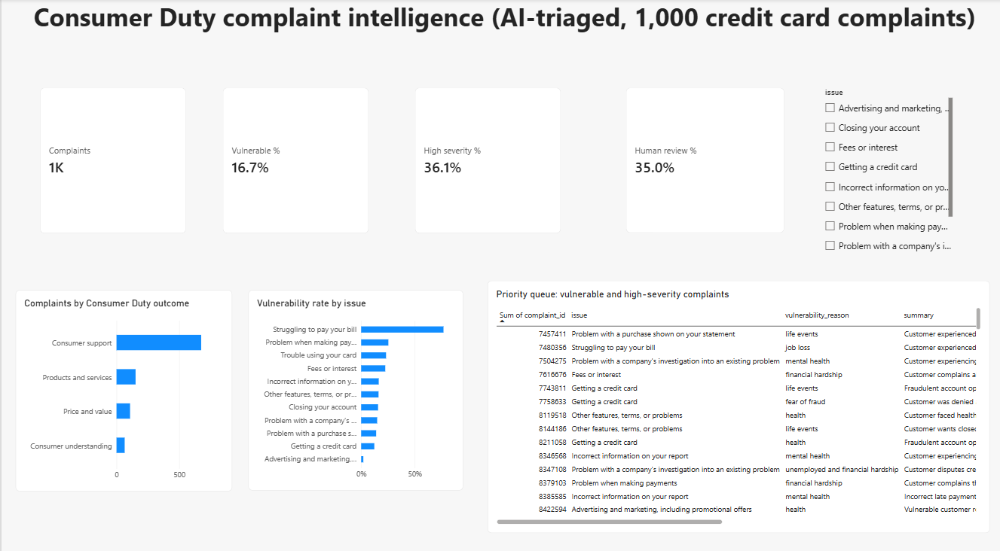
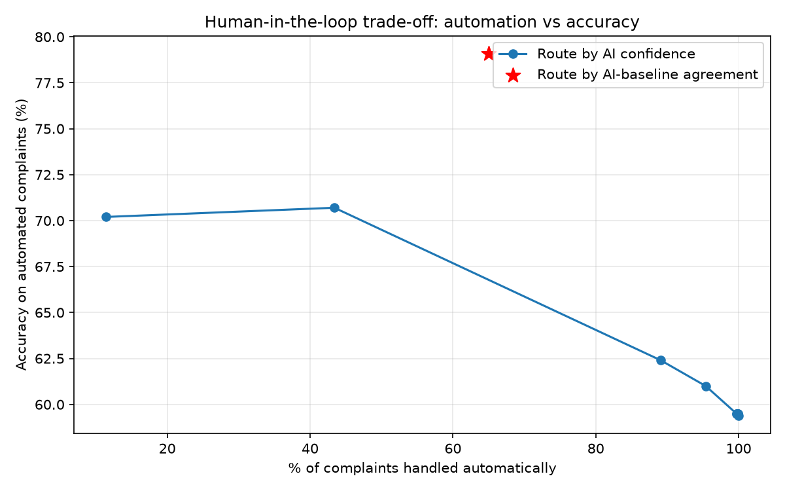
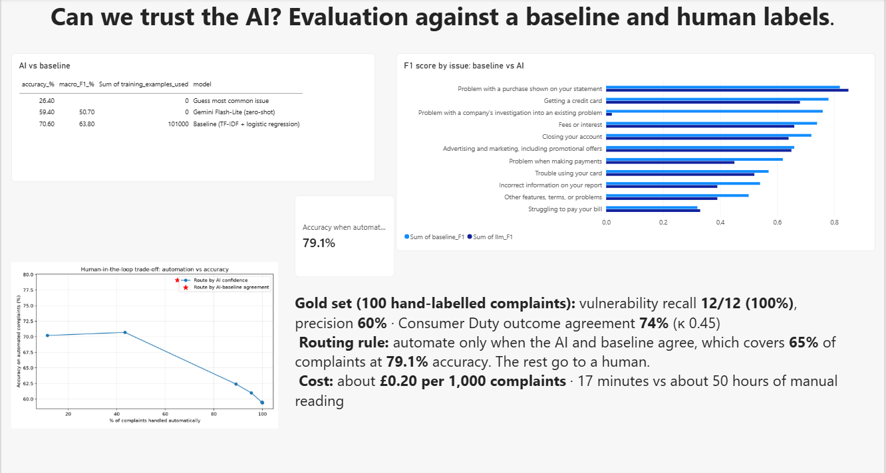

# Consumer Duty Complaints Intelligence: GenAI triage + an agentic SQL analyst, evaluated properly

**The finding:** a cheap, conventionally trained model beat a large language model at matching existing complaint labels (**70.6% vs 59.4%**), and the LLM was badly overconfident (**92% stated confidence vs 59% actual accuracy**). But used **together**, the two are better than either alone:

- **Routing rule:** automate a complaint only when the LLM and the baseline **agree**. That automates **65% of complaints at 79.1% accuracy**; the other 35% go to a human.
- **Vulnerable customers:** the LLM caught **12 of 12** vulnerable customers in a hand-labelled gold set (100% recall, 60% precision). It flagged **77%** of "struggling to pay" complaints, a category the baseline labelled correctly only **23%** of the time.
- **Cost:** about **£0.20 per 1,000 complaints** and 17 minutes of processing, against about 50 hours of manual reading.
- **Agentic AI:** an analyst agent that writes and runs its own read-only SQL scored **10/10** on a business-question exam, marked against an independently computed answer key.



---

## Why this project
Under the FCA's **Consumer Duty**, firms must spot poor customer outcomes quickly and give extra care to **customers in vulnerable circumstances**. Complaint text is where those signals live, but reading thousands of complaints by hand is slow. The question this project answers is not *"can an LLM classify complaints?"*. It is **"when can a bank trust it, and what should a human still do?"**

| Question | Answer |
|---|---|
| Does the LLM beat a simple trained model? | **No**, on matching existing labels (59.4% vs 70.6%) |
| Can we trust the LLM's own confidence? | **No:** it says 92%, it's right 59% of the time |
| Is there a better trust signal? | **Yes:** agreement between the two models (65% automated at 79.1%) |
| Does it find vulnerable customers? | **Yes:** 12/12 on the gold set, 77% of hardship complaints flagged |
| Does it map complaints to Consumer Duty outcomes? | 74% agreement with a human (Cohen's κ 0.45, moderate) |
| What does it cost? | ~£0.20 per 1,000 complaints |
| Can an AI agent answer business questions from the data? | 10/10 on a 10-question exam, with read-only guardrails |

---

## 1. Data: and a mid-project data-availability problem
- **Source:** US CFPB Consumer Complaint Database, **credit card** complaints with a customer-written narrative.
- **In August 2026 the CFPB stopped publishing complaint narratives**, and the website and bulk downloads no longer include the text. I sourced an **archived public snapshot taken before the change** (Hugging Face: `Mouwiya/cfpb-consumer-complaints`): 123,076 credit card complaints with narratives.
- **Cleaning:**
  - Fixed a **silent date bug**: mixed date formats were quietly turned into blanks, so "2025 only" showed 51 rows instead of tens of thousands. Fixed with `format="mixed"`, leaving 0 unreadable dates.
  - Kept **2023–2026** only (104,239 complaints), because the CFPB changed its credit card issue categories in 2017, so older labels aren't comparable.
  - Kept the **11 issues with 1,000+ complaints** and dropped 4 tiny ones (1.3%).
  - Removed the CFPB's privacy masking (`XXXX`, `XX/XX/year>`, `{$0.00}`) and dropped narratives left with fewer than 10 words.
- **Final:** 102,402 complaints (median 152 words).

| Set | Size | Purpose |
|---|---|---|
| Train | 101,402 | Trains the baseline; dev sample for prompt tuning |
| Test | 1,000 (stratified) | The exam: the baseline and the LLM answer the same complaints |
| Gold | 100 (from test) | Hand-labelled by me for vulnerability and Consumer Duty outcome |

## 2. Baseline: predictive AI
TF-IDF (words and word pairs) plus logistic regression, trained on 101k complaints.

| Model | Accuracy | Macro F1 |
|---|---|---|
| Always guess the most common issue | 26.4% | — |
| **Baseline** | **70.6%** | **63.8%** |

Its weak spot is **"Struggling to pay your bill"**: recall **0.23**, so it misses 77% of the complaints most linked to financial vulnerability.

## 3. GenAI triage: Gemini Flash-Lite
For each complaint the LLM fills in a **fixed JSON schema** (drop-down values only, so it can't invent labels):
`issue · consumer_duty_outcome · vulnerable · vulnerability_reason · severity · confidence · summary`

- **Prompt:** the role, the four Consumer Duty outcomes, and the FCA's **four drivers of vulnerability** (health, life events, resilience, capability). It's told to use only what the complaint says.
- **Settings:** temperature 0 (consistent answers), first 400 words, 5 complaints per call, retries with backoff, and a resumable run that saves after every batch.
- **Prompt engineering, done without leakage:** a 10-complaint pilot showed the LLM confusing "purchase disputes" with "company investigations". Prompt v2 added a category guide built from the **training** sub-issues. Both prompts scored **60%** on a 30-complaint **dev** set from the training data, so there was no measurable difference at that size. The test set was used once, at the end.
- **Model choice:** I started on Gemini Flash and moved to **Flash-Lite** after repeated server timeouts. Using the cheapest model that does the job is a deliberate choice.

## 4. Evaluation


**Overall**

| Model | Accuracy | Macro F1 | Labelled examples used |
|---|---|---|---|
| Baseline | **70.6%** | **63.8%** | 101,402 |
| Gemini Flash-Lite (zero-shot) | 59.4% | 50.7% | 0 |

**Where each model wins**
- The LLM wins on **"Problem with a purchase"** (F1 0.85 vs 0.82) and catches far more **"Struggling to pay"** complaints (recall **0.54 vs 0.23**).
- **The biggest single LLM error is a taxonomy boundary, not a reading failure.** 75 complaints the customer filed as *"company's investigation"* were called *"Incorrect information on your report"*. That's **18.5% of all LLM errors**, and both are credit-report problems.

**Is the LLM's confidence honest? No.**

| Stated confidence | Complaints | Actual accuracy |
|---|---|---|
| 0.80–0.90 | 106 | 34.9% |
| 0.90–0.95 | 457 | 54.5% |
| 0.95–1.00 | 434 | 70.7% |

The average stated confidence was 0.92, against **0.59 actual accuracy**.

**Human-in-the-loop routing**

| Rule | Automated | Accuracy on automated |
|---|---|---|
| Automate everything | 100% | 59.4% |
| LLM confidence ≥ 0.90 | 43.4% | 70.7% |
| **LLM and baseline agree** | **65.0%** | **79.1%** |

When the two models disagree (35%), the baseline is right 54.9% of the time and the LLM 22.9%, so these cases go to a human.

**Vulnerability and Consumer Duty, against my hand-labelled gold set (100 complaints)**

| Check | Result |
|---|---|
| Vulnerable customers caught | **12 of 12 (100% recall)**. With only 12 positives, the 95% lower bound is about 76% |
| False alarms | 8 (precision 60%) |
| Consumer Duty outcome | 74% agreement, Cohen's κ 0.45 (moderate) |

For vulnerability, **high recall with moderate precision is the right trade-off**. A false alarm costs a few minutes of review; a miss means a customer in difficulty gets no extra support.

Across all 1,000 complaints, the LLM flagged **16.7%** as vulnerable, ranging from **77%** of "struggling to pay" complaints down to **2%** of "advertising" complaints. **133 complaints (13%)** were both vulnerable and high severity: the dashboard's priority queue.

**Cost and speed:** 406 input and 107 output tokens per complaint. At Gemini 3.1 Flash-Lite paid prices ($0.25 / $1.50 per million tokens, checked 29 Oct 2026), that's **~£0.20 per 1,000 complaints** and 1.03 seconds per complaint. The project itself ran on the free tier, at £0.

## 5. Agentic AI: an analyst agent with one SQL tool
The agent gets a goal (a business question) and **one tool**, `run_sql`. It decides what to query, runs it, reads the result, and fixes its own errors if needed.

**Guardrails:**
- The database is opened **read-only**.
- **SELECT-only**: `DROP` and `DELETE` are blocked, and this is tested in the notebook.
- One statement per call, results capped at 50 rows.
- **Every query is logged** (an audit trail).

**Exam:** 10 business questions, marked against an answer key computed independently in SQL.
**Score: 10/10**, averaging 1.6 tool calls per question. The agent wrote joins, `HAVING`, conditional aggregation and subqueries on its own.

*Honest limits:* these were single-answer questions. Open questions ("why did complaints rise?") would need human review. One question also showed the **volume vs rate** trap: "purchase" complaints are the most common among vulnerable customers only because they're the biggest category. As a *rate*, "struggling to pay" is far higher.

## 6. Dashboard
Page 1 is complaint intelligence: Consumer Duty outcomes, vulnerability by issue, and the priority queue. Page 2 asks "Can we trust the AI?" (shown above).



## 7. Governance
See [`MODEL_RISK.md`](MODEL_RISK.md): intended use, limitations, data protection, monitoring and human oversight.

---

## Repository structure
```
00_setup_test.ipynb     Gemini API connection test (key in .env, never committed)
01_explore.ipynb        sourcing the archived narratives, date bug fix, taxonomy cut-off
02_prepare.ipynb        masking clean-up, 11 issues, train / test 1,000 / gold 100
03_baseline.ipynb       TF-IDF + logistic regression
04_llm_triage.ipynb     prompt v1 vs v2 on dev set, LLM triage of 1,000 test complaints
05_evaluate.ipynb       accuracy, per-issue F1, calibration, routing, vulnerability, cost, gold set
06_sql_agent.ipynb      agent with read-only SQL tool, guardrails, 10-question exam
consumer_duty_dashboard.pbix   Power BI dashboard
MODEL_RISK.md           AI governance note
data/clean/             test_1000.csv, gold sets (train.csv not committed: >100 MB)
outputs/                predictions, evaluation tables, charts
```

**To reproduce:** download the archived snapshot (notebook 01), add `GEMINI_API_KEY=...` to a `.env` file, and run the notebooks in order.

**Tools:** Python (pandas, scikit-learn, pydantic, matplotlib), Google Gemini API (`google-genai`: structured output, function calling), SQLite, Power BI (DAX).

## Limitations
- **US complaints, UK framing.** The CFPB data is American; the Consumer Duty mapping is my own UK lens on it.
- **Customer-chosen labels are noisy.** The "issue" label is picked by the complainant from a menu, so some of the LLM's "errors" are reasonable alternative readings.
- **Small gold set:** 100 complaints and a single annotator (me), labelled blind to the LLM output, with a keyword-hint column to speed up review. Twelve vulnerable cases is enough to be directional, not definitive.
- The dev set (30 complaints) was too small to separate the two prompts.
- The cost estimate uses list prices at one point in time, and the model behind `gemini-flash-lite-latest` can change, so results should be re-tested after model updates.
- The archived snapshot depends on a third-party copy of public data, now that the CFPB no longer publishes narratives.

## What I'd do with real firm data
- Use the firm's own complaint categories and its existing vulnerability flags as labels.
- Get two independent human labellers per gold complaint, and measure their agreement too.
- Run the LLM inside the firm's approved environment (no free tier; no customer data leaving the firm).
- Monitor monthly: agreement rate, vulnerability recall on a fresh human-labelled sample, and drift after model updates.
- Fine-tune or few-shot the LLM on the firm's labelled history, then re-run the same evaluation.
